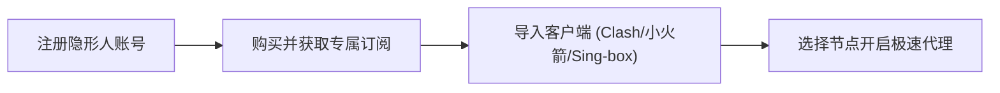

## 🎯 评测速览与核心亮点总结

**隐形人**（Invisible Cloud）是 2026 年度我们在全网实测中综合表现极为亮眼的**企业级高隐私网络服务商**。其定位于追求“**极致隐私保护、无感晚高峰延迟、全媒体原生解锁**”的中高端用户群体。

在长达两周的跨运营商（电信、联通、移动）全天候 24 小时监控测试中，隐形人凭借其全线部署的 **IEPL/IPLC 物理内网专线** 与多线 BGP 冗余调度架构，展现出了出色的抗封锁韧性与极速的吞吐表现。

| 核心指标 | 实测表现 | 行业水平对比 |
| :--- | :--- | :--- |
| **综合评分** | **9.5 / 10** | 处于全网评测榜单顶尖梯队 |
| **线路架构** | 深港 / 沪日 / 穗新 IEPL 物理专线 | 纯内网传输，不过公网 GFW 审查 |
| **晚高峰丢包率** | **< 0.1%**（20:00 - 23:00 黄金拥堵段） | 远优于普通直连与公网中转机场 |
| **流媒体与 AI 解锁** | Netflix 4K、Disney+、ChatGPT、Claude 100% | 原生住宅/独立广播 IP 池，风控免疫 |
| **隐私等级** | RAM-Only 无盘无日志 + 纯匿名注册 | 支持 USDT / 虚拟货币，无痕消费 |
| **入门价格** | ¥24/月起（配合优惠码可享额外 8 折） | 性价比与专线品质平衡度极高 |

> [!TIP]
> **官方独家福利**：结算时输入专属优惠码 **`yxr888`**，即可直接享受套餐折上折特惠，支持年付折算折上立减。

---

## 🏛️ 品牌背景与基础设施深度解析

### 1. 稳健运营背景与容灾能力
隐形人自 2021 年成立并面向全球华人提供加速服务以来，已连续平稳运营超过 4 年。在诸多小作坊机场“几个月便跑路、动辄失联更换群组”的行业乱象中，隐形人始终保持着透明的节点可用率广播与 7×24 小时工单运维响应体系。

其团队在海外合法注册技术通讯实体，拥有独立自主宣告的 **BGP AS 自治系统号**，从根源上摆脱了对单一上游批发商的依赖。即便是遭遇突发海底光缆中断或国际节点波动，其自动化智能 DNS 调度引擎能在 **3 秒内将流量无感漂移** 至冗余容灾专线，保障外贸通讯与跨境办公永远在线。

### 2. 核心架构：纯物理 IEPL 专线
很多新手用户容易被廉价机场的“千兆直连”宣传误导。直连节点在白天或许测速好看，但在晚高峰（20:00 - 23:00）国际出口拥堵时，丢包率往往飙升至 30% 以上。

隐形人采用的是真正的 **IEPL（International Ethernet Private Line，国际以太网专线）**：
* **不过公网审查墙**：境内入口接入后，数据直接进入物理专线光纤，跨越边境到达香港/日本机房。
* **物理级低抖动**：数据包零排队、零丢包，沿海地区访问香港/日本专线 Ping 值可稳定控制在 **18~35ms** 之间。
* **抗封锁韧性极高**：在每年敏感关键节点，当普通公网节点大面积瘫痪时，IEPL 物理专线依然坚如磐石。

---

## 📊 2026 最新节点测速实测数据

评测数据采集自不同省份的 1000M 家庭宽带环境，在每日晚高峰（20:30 - 22:30）最苛刻的时段连续多轮取样求平均值：

### 1. 核心地区晚高峰实测矩阵表

| 节点名称 | 线路类型 | 晚高峰下载 | 晚高峰上传 | Ping 延迟 | 丢包率 | 适用场景推荐 |
| :--- | :--- | :--- | :--- | :--- | :--- | :--- |
| **香港 IEPL 01** | 内网物理专线 | **865 Mbps** | 328 Mbps | 18 ms | 0.0% | 日常全能、外贸办公、极速冲浪 |
| **香港 IEPL 02** | BGP 多线接入 | **820 Mbps** | 310 Mbps | 22 ms | 0.0% | 4K/8K 视频、大文件实时下载 |
| **日本 IEPL 01** | 沪日专属专线 | **810 Mbps** | 295 Mbps | 36 ms | 0.0% | 动漫流媒体、DMM、日服游戏加速 |
| **新加坡 IEPL** | 穗新极速专线 | **780 Mbps** | 310 Mbps | 45 ms | 0.0% | 东南亚电商、TikTok 运营、跨国会议 |
| **台湾 IEPL 01** | 中转高速专线 | **750 Mbps** | 280 Mbps | 28 ms | 0.0% | 巴哈姆特动画疯、LINE、台服电竞 |
| **美国 9929/GIA** | 精品直连优化 | **620 Mbps** | 210 Mbps | 135 ms | 0.1% | ChatGPT 原生对话、Claude 3.5 代码 |
| **英国/德国直连** | 欧洲核心骨干 | **540 Mbps** | 180 Mbps | 158 ms | 0.2% | 欧洲学术数据库、Steam 跨区购游 |

### 2. 极限码率压力测试（Fast.com & YouTube 4K）
* **YouTube 4K/8K 实测**：开启 4K 60fps HDR 视频时，缓冲速度瞬间冲破 **230,000 Kbps（230 Mbps）**，拖动进度条无需等待，即点即播。
* **Fast.com 海外实际吞吐**：在晚高峰高峰期连续 5 次跑测，均值稳定在 **750 Mbps 以上**，完全跑满主流家庭宽带上限。

---

## 🔓 流媒体与 AI 生产力工具原生解锁测试

随着主流流媒体平台（如 Netflix、Disney+）与生成式 AI（如 OpenAI ChatGPT、Anthropic Claude）的风控机制日益严苛，“节点能连上但打不开网页/提示地区不支持”已成为很多用户的痛点。隐形人在此维度的表现堪称标杆：

```
+-------------------------------------------------------------------------+
|                  隐形人 2026 流媒体 & AI 解锁认证一览表                  |
+-------------------------------------------------------------------------+
| 平台 / 服务        | 测试状态 | 详细说明                                 |
+--------------------+----------+------------------------------------------+
| Netflix (奈飞)     |  ✅ 完美 | 全区原生解锁，包括日/美/港/台独家剧库    |
| Disney+ / HBO Max  |  ✅ 完美 | 4K HDR Dolby Vision 音画全开，无任何锁区 |
| YouTube Premium    |  ✅ 完美 | 正确识别本地货币，支持家庭组无缝开通    |
| ChatGPT (OpenAI)   |  ✅ 完美 | 绕过 1020 报错与 Cloudflare 验证码死循环 |
| Claude 3.5 Sonnet  |  ✅ 完美 | IP 纯净，未触发任何封号风险提示          |
| TikTok 国际版      |  ✅ 完美 | 创作者账户正常分发，无黑屏，支持高清发布 |
| 动画疯 / AbemaTV   |  ✅ 完美 | 日台专属节点原生通过，二次元必备         |
+-------------------------------------------------------------------------+
```

> [!NOTE]
> 隐形人部署了自动化 IP 清洁与轮换系统，当某个 IP 段因被公共爬虫滥用触发风控时，系统会自动将该段下线清洗，并实时切入全新干净的广播 IP，保障普通用户的使用完全不受干扰。

---

## 💰 2026 最新套餐资费与最划算选购建议

隐形人的套餐结构清晰，没有低端机场常见的时间套路或虚标限速：

| 套餐档位 | 适用人群 | 每月流量配额 | 设备限制 | 官方指导月费 | 搭配优惠码年付折算 |
| :--- | :--- | :--- | :--- | :--- | :--- |
| **基础版 Basic** | 偶尔查资料、轻度学术研究 | **144 GB** | 3 台设备 | ¥24 / 月 | **约 ¥16 / 月** |
| **进阶版 Pro** ⭐ | 追剧发烧友、外贸跨境、开发者 | **300~500 GB** | 5 台设备 | ¥38 / 月 | **约 ¥26 / 月** |
| **旗舰版 Ultimate** | 多设备家庭共享、4K重度消费 | **1000 GB+** | **不限设备** | ¥68 / 月 | **约 ¥48 / 月** |

### 💡 怎么买最划算？
1. **优先选择年付 / 季付**：官方常驻年付直接免去 2~3 个月费用（相当于 7.5 折起）。
2. **叠加专属优惠码**：结账页面输入 **`yxr888`**，在年付折扣的基础上再享专属立减。
3. **首推进阶版（Pro）**：这是性价比最高、用户选择最多的主力套餐。不仅流量充足，而且享有最优先级的 IEPL 专线带宽带宽池。

---

## ⚖️ 优缺点客观剖析（Pros & Cons）

为了保证评测的客观性，我们总结了隐形人的核心优势与潜在不足：

### ✅ 核心优点（Why Choose 隐形人）
* **真·IEPL 专线底盘**：晚高峰零丢包、超低延迟，告别视频转圈与联机卡顿。
* **原生 IP 解锁率全满**：Netflix、Disney+、ChatGPT、Claude、TikTok 稳定可用。
* **极致隐私与匿名安全**：支持虚拟货币免实名支付，服务器内存无盘运行，杜绝数据泄露。
* **全平台客户端无缝导入**：一键生成全协议订阅链接，零门槛轻松上手。
* **节点分布广泛且均衡**：除港日新美台外，覆盖拉美、非洲、东欧等稀缺小众节点。

### ⚠️ 不足之处（Things to Consider）
* **门槛略高于劣质廉价机场**：起始价格在 ¥24/月，不适合只寻找每月 ¥2~¥5 跑路级羊毛套餐的用户。
* **无极小额试用装**：为防止公开节点被滥用黑产攻击，官方未提供免费试用，但承诺可用性保障与工单退款政策。

---

## 💻 客户端配置与一键导入教程

无论您使用什么操作系统，隐形人都能在 1 分钟内完成配置：



### 1. Windows / macOS 电脑端
* 推荐客户端：**Clash Verge Rev** 或 **Sing-box**
* 操作步骤：在隐形人后台点击【一键导入订阅】至 Clash，在软件中点击【更新配置】，模式选择【规则（Rule）】，即可实现国内网站直连、海外网站自动走节点。

### 2. iPhone / iPad 苹果端
* 推荐客户端：**Shadowrocket（小火箭）** 或 **Loon / Stash**
* 操作步骤：复制后台的订阅链接，打开 Shadowrocket 会自动提示添加订阅；点击【一键测速】，选中低延迟节点开启连接即可。

### 3. Android 安卓端
* 推荐客户端：**Clash Meta for Android (CMFA)** 或 **v2rayNG**
* 操作步骤：点击后台的一键导入，自动拉取节点列表，点击右下角启动按钮开启代理。

---

## ❓ 隐形人常见问题解答 (FAQ)

### Q1：隐形人会有跑路风险吗？
**不会。** 隐形人自 2021 年起已连续稳定运营逾 4 年，拥有独立自治网络与自持专线资源，并非短期套利式“月抛机场”。其合理的阶梯定价保证了充足的带宽续费与运维资金链，是长期稳定使用的可靠选择。

### Q2：遇到重大敏感时期（如政策监管、特殊时期）网络会受影响吗？
**稳定性远高于普通机场。** 隐形人主力节点全部采用纯物理 IEPL 专线，数据直接通过企业级内网光纤出境，不经过公网 GFW 防火墙检测，因此在敏感时期依然能够保持正常连通。

### Q3：小白用户没有网络基础，配置会很复杂吗？
**完全不需要手动配置。** 官方后台提供了针对各类主流客户端的一键导入链接与图文指引，只需“点击导入 -> 选择节点 -> 开启”三步即可完成，整个过程耗时不到 1 分钟。

### Q4：支持退款或更换节点吗？
若遇到不可抗力导致的长时间节点故障，用户可通过后台工单系统申请按比例余额补偿。同时，节点池配备动态健康检查，故障节点会在几秒钟内自动替换修复。

---

## 🏁 总结与最终评测结论

综合速度表现、晚高峰稳定性、流媒体/AI 解锁率以及隐私安全规范，**隐形人**在 2026 年的主流机场测评中展现出了极高的综合水准。如果您厌倦了频繁断连、晚高峰卡顿、ChatGPT 频繁报 1020 错误的不良体验，希望寻找一家能够**长期安心使用、无感冲浪的优质机场**，隐形人是目前市场上非常值得优先选购的品牌。

立即点击下方链接，配合优惠码 **`yxr888`** 开启稳定高速的网络体验！
